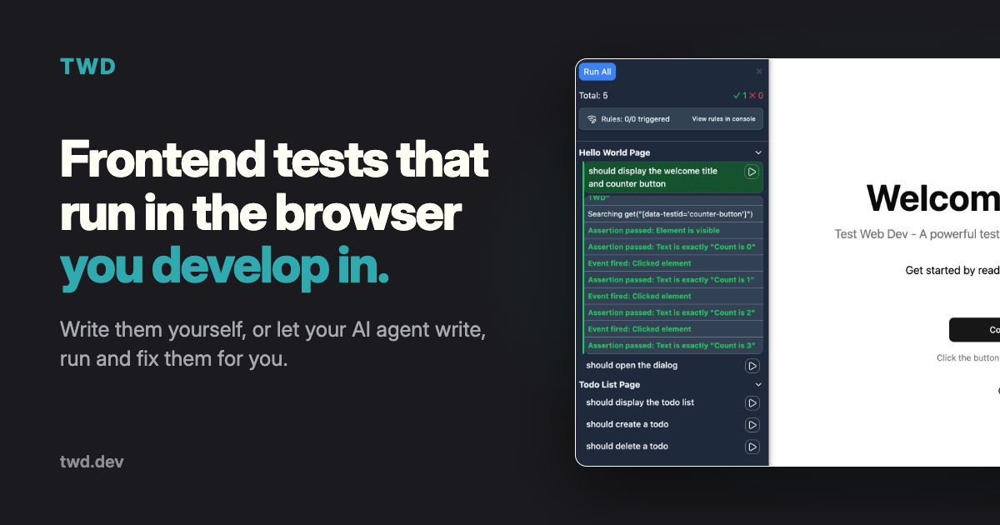
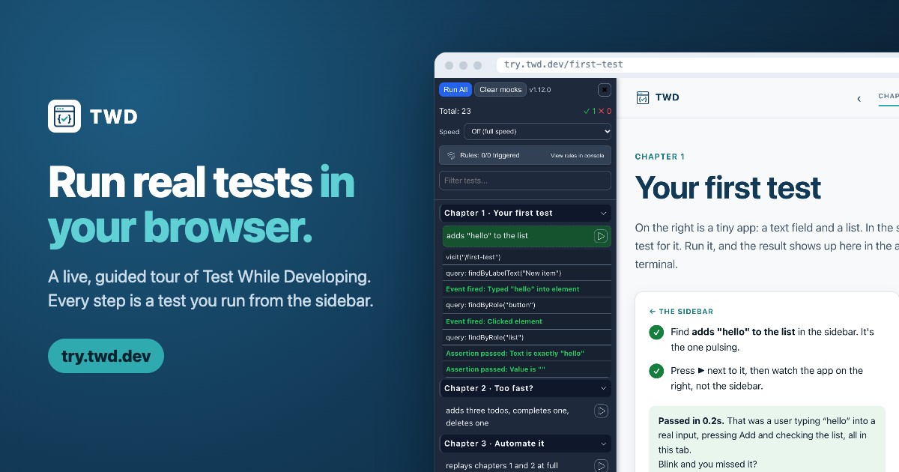
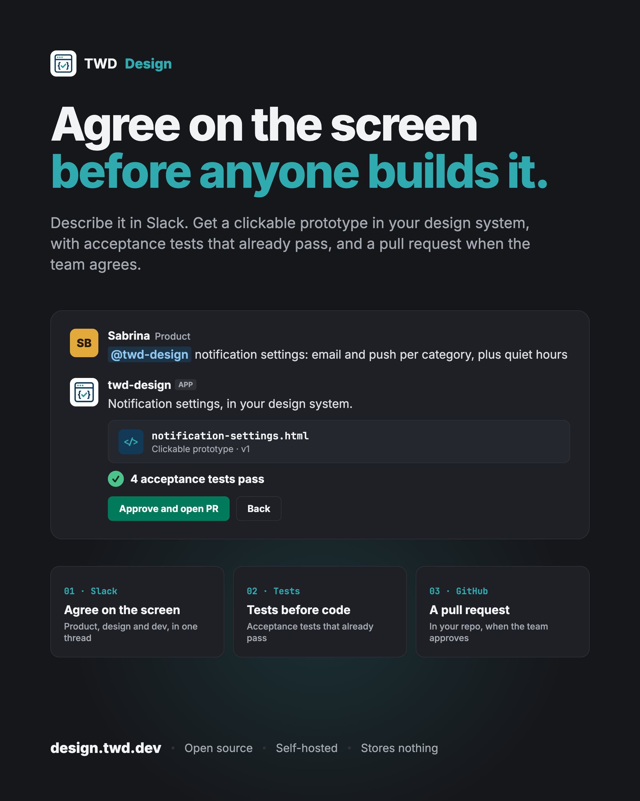

# Hi, I'm Kevin 👋

Software Architect at [Orbitant](https://github.com/weorbitant), based in Madrid. I created **TWD (Test While Developing)**, an open source testing ecosystem I build with the team at [BRIKEV](https://github.com/BRIKEV).

I care about testing strategy, developer experience and adopting AI responsibly. The idea behind everything I work on: tests should run while you develop, not after, whether you write them or your AI agent does.

## TWD - Test While Developing

Frontend tests that run in the browser you develop in, against your real app. No jsdom, no separate E2E stack. Works with React, Vue, Angular, Solid, Astro, Nuxt and more.

  

| Project | Version | What it does |
|---------|---------|--------------|
| [twd-js](https://github.com/BRIKEV/twd) |  | In-browser test runner with a live sidebar UI. |
| [twd-cli](https://github.com/BRIKEV/twd-cli) |  | Headless runner for CI and AI agents, with coverage. |
| [twd-lint](https://github.com/BRIKEV/twd-lint) |  | Catches test mistakes (missing `await`, Vitest imports, leftover `it.only`) in the editor and in CI, and fixes the safe ones. [Docs](https://twd.dev/linting) |
| [twd-ai](https://github.com/BRIKEV/twd-ai) | | Claude Code plugin and Agent Skills: your agent writes, runs and fixes TWD tests. |
| [openapi-mock-validator](https://github.com/BRIKEV/openapi-mock-validator) |  | Checks every API mock against the real OpenAPI spec. |

Start at [twd.dev](https://twd.dev/). The thinking behind the approach lives in [twd-principles](https://github.com/BRIKEV/twd-principles).

### Try it in 2 minutes

[try.twd.dev](https://try.twd.dev/) is a live, guided tour. Every step is a real test you run from the sidebar, no install needed.

  

### TWD Design

[design.twd.dev](https://design.twd.dev/): agree on the screen before anyone builds it. Describe a screen in Slack and get a clickable prototype in your design system, with acceptance tests that already pass, and a pull request when the team approves. Open source, self-hosted, stores nothing.

  

## Writing

I write about testing, software factories and building Claude Code skills on my blog, [kevinmartinez.dev](https://kevinmartinez.dev/). Some recent posts:

- [A Software Factory Is a Trust Problem More Than a Speed Problem](https://kevinmartinez.dev/posts/a-software-factory-is-a-trust-problem-more-than-a-speed-problem)
- [Chain of Custody: Every Requirement Arrives Signed For](https://kevinmartinez.dev/posts/chain-of-custody-every-requirement-arrives-signed-for)
- [Evals tell you which parts of your skill to delete](https://kevinmartinez.dev/posts/evals-tell-you-which-parts-of-your-skill-to-delete)
- [The score tells you what failed. The trace tells you why.](https://kevinmartinez.dev/posts/the-score-tells-you-what-failed-the-trace-tells-you-why)

Articles are also cross-posted on [dev.to](https://dev.to/kevinccbsg).

## Talks and podcasts

- [TWD: Una nueva forma de testear el frontend](https://www.youtube.com/watch?v=F0b63Cl6_Mo) (Spanish)
- [Testing while developing: una nueva forma de testear en frontend](https://www.youtube.com/watch?v=qsHowBWgJn8) (Spanish)
- Podcast: [Una nueva forma de testear frontend con TWD](https://www.youtube.com/watch?v=qkFe4kayGIw) (Spanish, also on [Spotify](https://spotifycreators-web.app.link/e/a6xQdwYSF0b))
- Podcast: [How to Test This #14: How to Test with Testing While Developing (TWD)](https://youtu.be/O4QahYTYQgE) (English, also on [Spotify](https://open.spotify.com/episode/6mQV2liEL68mM9JqRXpPVo))

More videos on the [TWD YouTube channel](https://www.youtube.com/@twd-dev).

## Reach me

- [kevinmartinez.dev](https://kevinmartinez.dev/)
- [LinkedIn](https://www.linkedin.com/in/kevinjmartinez/)
- [Bluesky](https://bsky.app/profile/kevintwd.bsky.social)
- [dev.to](https://dev.to/kevinccbsg)
